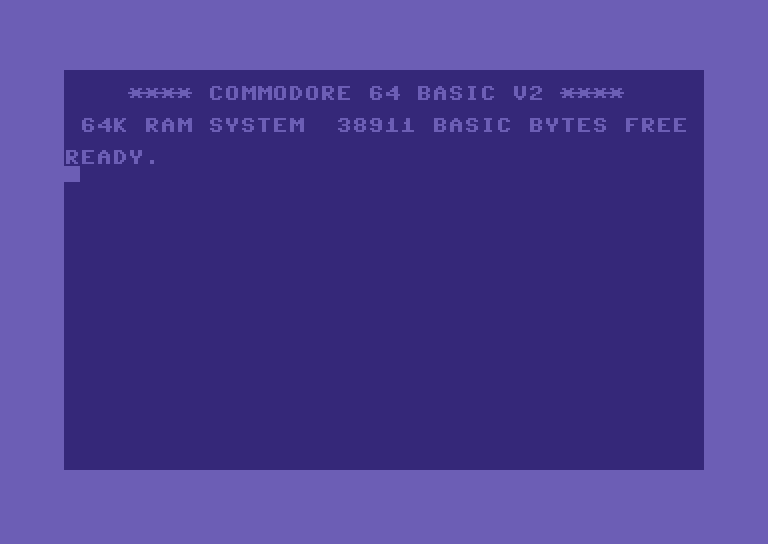
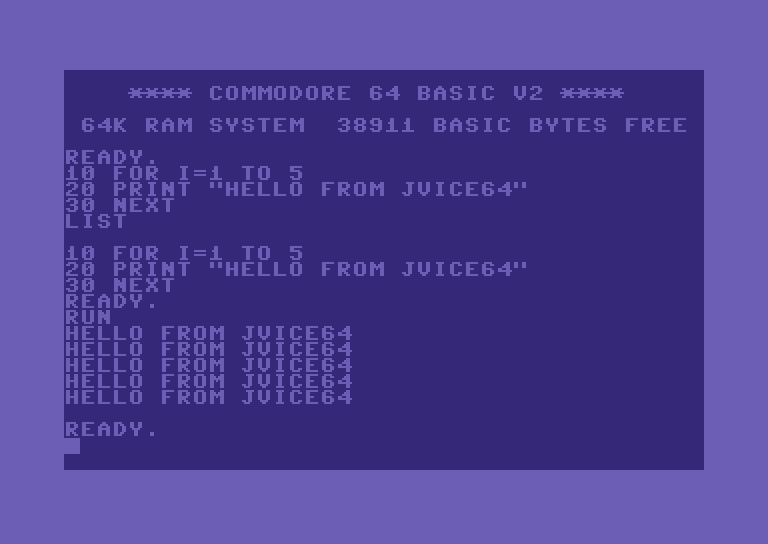

# JVice64

A Commodore 64 emulator in **pure Java (1.8) / Maven**, inspired by
[VICE](https://vice-emu.sourceforge.io/). It runs C64 programs on the **native C64 ROMs**
(KERNAL, BASIC, character generator), which you supply yourself, and loads programs in the usual
`.prg`, `.p00`, `.t64` and `.d64` formats, with **video and audio** output.
It also includes a built-in browser for a game-disk collection you own
(see [Game collection browser](#game-collection-browser)).

The machine boots to `READY.` in about two emulated seconds, and BASIC is ready to use:

| Boot screen | A first BASIC program |
|---|---|
|  |  |

*Captured from the emulator's framebuffer, using ROMs supplied separately.*

## Download

The latest build is published as a GitHub **release**:

- **[JVice64 v1.1.2](https://github.com/DenzoSOFTHub/JVice64/releases/tag/v1.1.2)** —
  download `jvice64.jar` and run it with `java -jar jvice64.jar`.

The jar does **not** contain the C64 ROMs — you must supply them yourself (see
*C64 ROMs* below). Java 8+ required.

## C64 ROMs (required — you must obtain them)

The Commodore C64 ROMs are copyrighted, so they are **not** included in this
repository **nor bundled in the jar**. You must **obtain the dumps yourself** and
put them in a **`roms/` folder** for the emulator to load at runtime:

| File          | Size  | What                              |
|---------------|-------|-----------------------------------|
| `kernal.bin`  | 8 KB  | KERNAL (required)                 |
| `basic.bin`   | 8 KB  | BASIC V2 (required)               |
| `chargen.bin` | 4 KB  | character ROM (required)          |
| `dos1541.bin` | 16 KB | 1541 DOS (optional; true-drive)   |

Where to put the folder — the first match wins, and the choice is **saved in the
settings**:

1. the folder remembered in the settings (`roms.dir`), or `-Djvice64.roms=<DIR>`;
2. **`roms/` next to the jar** (recommended), or `./roms` in the working directory;
3. `~/.jvice64/roms`.

If none is found, the GUI asks you to **pick the folder once** (File → *Set C64
ROMs folder…* changes it later); both are remembered. Headless mode needs the
folder via one of the paths above (e.g. `-Djvice64.roms=…`).

## Build

```sh
mvn package
```

Produces a runnable jar at `target/jvice64.jar` (ROMs are loaded externally at
run time, as above — they are not compiled in).

## Run

GUI (Swing window, ~50 Hz PAL, audio via `javax.sound`):

```sh
java -jar target/jvice64.jar                 # just boot to READY.
java -jar target/jvice64.jar game.prg        # boot and autostart a program
java -jar target/jvice64.jar disk.d64        # autostart first PRG on a disk
```

Headless boot/verification mode (no window — prints the 40×25 screen RAM as
text; handy for CI and quick checks):

```sh
java -jar target/jvice64.jar --headless 200 [program]
```

Optional flags, valid for this run only (they are not saved in the settings):

| Flag          | Effect                                      |
|---------------|---------------------------------------------|
| `--ntsc`      | NTSC timing and palette (default PAL)       |
| `--8580`      | 8580 SID (default 6581)                     |
| `--truedrive` | real 1541 drive emulation (GUI only)        |

### In the window

- **File → Open recent** — the last **8** programs you loaded, reloaded in one
  click. Disk entries come back through the same `.d64` entry they
  were launched from, plain files through the normal loader; picking one moves it
  back to the top. Entries whose file has since moved or been deleted are dropped
  silently, and *Clear list* empties it. The list lives in `jvice64.properties`
  (`recent.N.title` / `.path` / `.entry`).
- **Games → Browse game collection…** — open a browser of an indexed folder of
  `.d64` game disks that you own, **sorted by name**, with a search filter, a
  per-game **favourites** toggle (★, persisted to `~/.jvice64-favorites`) and a
  *favourites only* view (the collection is scanned on a worker thread with a
  progress bar). Double-click a row (or the Launch button) to start the game — it resets the machine, mounts the disk on device 8 and autostarts the
  selected program. **Games → Set game collection folder…** picks the collection
  directory.
- **File → Open program…** — load a `.prg` / `.p00` / `.t64` / `.d64` and
  autostart it.
- **File → Attach disk to drive 8 (no autostart)…** — mount a disk image and leave
  the machine at `READY.`, so you can `LOAD` from it yourself.
- **File → Save state… / Load state…** — snapshot and restore the **full** machine
  (CPU, RAM/colour RAM, VIC-II, both CIAs, **SID**, cartridge banking and the
  **true-1541 drive**). Snapshots live in a `snapshots/` folder next to the jar; quick
  save/load use a **per-game slot** named after the loaded program.
- **Controls → Enable audio** + **volume slider** — audio starts **off**; enable it
  and set the SID playback volume (0–100). Both are remembered between runs.
- **Machine** menu / hotkeys — **F9** pause/resume (PAUSED overlay), **F10**
  screenshot (PNG), **F11**/**F12** start/stop **video recording** — an **AVI with
  video *and* audio** (the run's SID sound is captured even if the speakers are off),
  **F2**/**F4** quick save / quick load (per-game). Screenshots and recordings go to
  the home folder as `jvice64-<timestamp>.png` / `.avi`. A recording is written to
  disk while it runs, so its length is limited by disk space, not memory; it stops
  by itself at about 1.9 GB (the AVI 1.0 size limit). Closing the window during a
  recording still leaves a playable file.
- The window is **freely resizable**: the C64 screen scales to fill the space
  while keeping its aspect ratio (letterboxed, never stretched/distorted).
- **File → Use real 1541 drive** — toggle true-drive emulation.
- **File → Reset** — reset the machine.
- Keyboard is **positional** (host keys map to the C64 key in the same place).
  - `Page Up` = **RESTORE** (RUN/STOP + RESTORE warm-starts BASIC).
  - `Escape` = **RUN/STOP**, `Tab`/`Alt` = **C=** (Commodore), `Ctrl` = **CTRL**.
  - `Home` maps as expected. The **arrow keys drive the joystick** and do not move
    the C64 cursor by default; see *Joystick* below to change this.
  - **C64 function keys** — the C64 has four function keys that double as eight
    (the even ones are *shifted*), and they map to the host like this:

    | C64 key | Host key      | C64 key | Host key            |
    |---------|---------------|---------|---------------------|
    | **F1**  | `F1`          | **F2**  | `Shift`+`F1`        |
    | **F3**  | `F3`          | **F4**  | `Shift`+`F3`        |
    | **F5**  | `F5`          | **F6**  | `Shift`+`F5`        |
    | **F7**  | `F7`          | **F8**  | `Shift`+`F7`        |

    i.e. `F1`/`F3`/`F5`/`F7` go straight through, and you get the C64's
    `F2`/`F4`/`F6`/`F8` by holding `Shift` — exactly as on real hardware.
    > Note: the host `F2`, `F4` and `F9`–`F12` keys are **reserved for emulator
    > functions** (quick save/load, pause, screenshot, recording — see the
    > *Machine* menu) and do **not** reach the C64. Use `Shift`+`F1`/`F3`/`F5`/`F7`
    > for the C64's even function keys, or click them on the on-screen keyboard.
- **Controls → Show virtual keyboard** — an on-screen Commodore 64 keyboard in a
  separate window: click any key to drive the emulated keyboard matrix (CTRL /
  C= / SHIFT / SHIFT-LOCK are sticky toggles so shifted characters and the
  shifted `F2`/`F4`/`F6`/`F8` work with a single mouse). The window never steals
  keyboard focus, so the host keyboard keeps working alongside it.

### Joystick — using the keyboard (or a USB pad)

Most games are joystick-controlled. You don't need a physical joystick: the host
keyboard drives the emulated one. Two key sets work (use whichever you like):

| Action      | Arrow-key set         | Numeric keypad (NumLock on)      |
|-------------|-----------------------|----------------------------------|
| Up/Down/L/R | **Arrow keys**        | `8` / `2` / `4` / `6`            |
| Diagonals   | (two arrows together) | `7` / `9` / `1` / `3`            |
| **Fire 1**  | **Space**             | `0` or `5`                       |
| **Fire 2**  | **Ctrl**              | `.` (decimal)                    |

- **Which port?** Use **Controls → Joystick: both / port 2 / port 1**. Most games
  read **port 2** (the default covers both). The choice is remembered.
- **Fire 2** is the second button of a 2-button joystick, carried on the POTY line
  (SID `$D41A`). Only the few games that support a 2-button joystick respond to it;
  a standard 1-button game ignores it.
- **Cursor keys while typing:** joystick direction keys reach only the joystick by
  default, because the C64 keyboard and the control ports share the same CIA lines,
  and a game could otherwise read two directions at once. Tick **Controls → Joystick
  keys also type (arrows = cursor)** to use the arrows as cursor keys. Fire keys always
  reach the keyboard too, so "PRESS SPACE" prompts work.
- **USB joystick / gamepad** (optional): plug one in and it's auto-detected at
  launch (or use **Controls → Detect USB joystick…** for hot-plug). Left stick or
  D-pad = directions, the lower face button = fire 1, the right face button = fire 2.
  This needs no native library — on **Linux** it reads `/dev/input/jsN`, on
  **Windows 10/11** it uses the built-in PowerShell + `Windows.Gaming.Input` (XInput /
  Xbox-style pads). On macOS / other setups it stays idle and you use the keyboard.

### Two players

Tick **Controls → Two players (split control ports)** and the inputs split across
the two C64 control ports, so two people can play at once:

| | Player 1 (control port 2) | Player 2 (control port 1) |
|-------------|---------------------------|----------------------------------|
| Keyboard    | **Arrow keys**, Space = fire 1, Ctrl = fire 2 | **keypad** `8`/`2`/`4`/`6` (+ `7`/`9`/`1`/`3` diagonals), `0` = fire 1, `.` = fire 2 |
| USB pad     | first pad plugged in      | second pad plugged in            |

- The two sources of a port are **combined**, so a player can use the keyboard and
  a pad interchangeably without one cancelling the other's held direction.
- **No numeric keypad?** (laptops) Tick **Player 2 also on WASD** — `W`/`A`/`S`/`D`
  with Left Shift = fire 1 and `Q` = fire 2. It is off by default, because otherwise
  those letters would move the stick while you type.
- Player 1 gets **port 2** (what single-player games read). Selecting
  **Joystick: port 1** swaps the two players over.
- With two players off, everything behaves exactly as before: arrows and keypad both
  drive the same stick.

### Changing the joystick keys

**Controls → Configure joystick keys…** opens an editor for both players: click an
action, then press the key you want (Esc cancels). Assigning a key that another
action already uses clears it there first, so one key never drives two things.
*Restore defaults* puts back the table above.

The bindings live in `jvice64.properties` and can also be edited by hand:

```properties
joystick.p1.up=VK_UP
joystick.p1.fire=VK_SPACE
joystick.p2.up=VK_NUMPAD8
joystick.p2.fire=VK_NUMPAD0
joystick.twoplayer=true
joystick.wasd=false
```

Names are AWT `VK_*` constants. An entry that is missing or misspelled falls back to
that player's default, so a hand-edited file can't leave a player without controls.

## Game collection browser

JVice64 can browse and launch the games of a C64 disk collection that you own: a folder
of numbered `.d64` images indexed by an `00index-by-volume.txt` file:

```
Games Volume 001
1 - First Game
2 - Second Game

Games Volume 002
1 - Third Game
```

The name before `Volume` gives the disk file names (here `games001.d64` and
`games002.d64`), and each game's number is the name of its program on that disk.

- Open it from **Games → Browse game collection…**. The browser lists every game
  **sorted by name**, with a **search filter**, the volume number, and a per-game
  **favourites** star (★, persisted to `~/.jvice64-favorites`) plus a *favourites
  only* view. The collection is scanned on a background thread with a progress bar.
- **Double-click a row** (or select it and press **Launch**) to start the game: the
  machine resets, the right `.d64` image is mounted on device 8, the chosen program
  is autostarted, and the browser closes automatically.
- **Games → Set game collection folder…** picks the collection directory; it is
  **remembered** in the settings. The folder is recognised by the presence of
  `00index-by-volume.txt`, and only games whose `.d64` image exists are listed.

> No disk images or games are included with JVice64 — point it at your own
> files. Individual `.d64` files also work via **File → Open program…**.

## Supported file formats

| Ext   | Description                          | Notes                                   |
|-------|-------------------------------------|-----------------------------------------|
| `.prg`| Raw program (2-byte load address)   | `$0801` BASIC programs auto-`RUN`        |
| `.p00`| PC64 single-file container          | 26-byte `C64File` header                 |
| `.t64`| Tape archive                        | first file autostarted                   |
| `.d64`| 1541 disk image (35/40 track)       | first usable PRG autostarted; mounted on device 8 |
| `.crt`| Cartridge image                     | 8K / 16K / Ultimax + bank-switching (Ocean, Magic Desk); CBM80 autostart |
| `.tap`| Datasette tape image                | pulse stream → cassette read line (CIA1 FLAG)            |

Programs are injected at their load address and started via the KERNAL keyboard
buffer (`RUN` for BASIC, `SYS` otherwise) once BASIC reaches its idle loop.

### Device 8 (KERNAL LOAD trap)

Opening / attaching an image also mounts it on **device 8**, and the KERNAL LOAD
vector ($F4A5) is trapped, so programs and direct mode can load from it:

```basic
LOAD"$",8        : LIST      directory listing
LOAD"*",8        : RUN       first PRG on the disk
LOAD"NAME",8               relocated load (BASIC)
LOAD"NAME",8,1            load at the file's own address
```

Wildcards (`NAME*`) and a `0:` drive prefix are accepted.

**SAVE** is also supported — `SAVE"NAME",8` writes a new PRG into the mounted
D64 (allocating blocks in the BAM, writing the sector chain and a directory
entry) and persists the modified image back to the host `.d64` file. Saving over
an existing name replaces it. If no disk is mounted, a standalone `.prg` is
written next to the last-attached file (or the working directory).

**Sequential files** work too: `OPEN 2,8,2,"NAME,S,W"` / `PRINT#` / `INPUT#` /
`GET#` / `CLOSE` read and write real SEQ files on the mounted D64 (written back
to the host image on `CLOSE`). The `,R` / `,W` / `,A` (append) modes and the
`S` / `P` / `U` file types are honoured, and a `0:` or `@0:` prefix is accepted.

```basic
OPEN 2,8,2,"SCORES,S,A" : PRINT#2,"NEW" : CLOSE 2    append to an existing file
OPEN 1,8,0,"$" : GET#1,A$                          read the directory byte by byte
OPEN 15,8,15 : INPUT#15,E,E$,T,S : CLOSE 15        read the drive status ("00, OK,00,00")
OPEN 15,8,15,"S:OLDFILE" : CLOSE 15                scratch (delete) a file
```

The command channel (secondary address 15) always opens. `S:` (scratch) is carried
out on the disk image; other DOS commands (`I`, `V`, `M-W`, ...) are accepted and
answer `00, OK`, because no drive CPU runs in this mode.

In this default mode no 1541 CPU runs, so custom fast-loaders and drive code do not
work; `LOAD`, `SAVE`, the directory and sequential files are all serviced by traps.
For drive code, use **File → Use real 1541 drive** (see *Known limitations*).

## Architecture

```
it.denzosoft.jvice64
├── Main            entry point (GUI + --headless harness, ROM loading)
├── C64             machine wiring + PAL frame loop + NMI/IRQ + autostart
├── cpu/Cpu6510     MOS 6510 core (full documented + undocumented/illegal
│                   opcodes, decimal mode, IRQ level / NMI edge)
├── io/KernalTrap   device-8 traps: LOAD/SAVE/directory + sequential files
│                   (OPEN/CHKIN/CHKOUT/CHRIN/CHROUT/GETIN/CLRCHN/CLOSE)
├── mem/C64Memory   64K RAM + full 32-config PLA bank switching ($00/$01 +
│                   cartridge EXROM/GAME, ROML/ROMH), I/O routing, VIC view
├── io/Joystick     both control ports, keyboard + USB pad per port, two players
├── io/JoyBinding   editable key bindings, persisted as VK_* names
├── Region          PAL/NTSC timing (clock, raster geometry, refresh)
├── debug/Disassembler   6502 disassembler + hex dump (monitor)
├── media/Cartridge,Crt   .crt parser (generic 8K/16K/Ultimax)
├── media/Tap,Datasette   .tap parser + cassette pulse playback
├── vic/VicII       VIC-II: text (hires/MC/ECM), bitmap (hires/MC), 8 sprites
│                   (expand/MC/priority/collisions), border, raster IRQ
├── cia/Cia,Cia1,Cia2  6526 timers A/B + TOD + IRQ/NMI; keyboard; VIC bank
├── sid/Sid         6581/8580 sound: 3 voices, ADSR, waveforms, filter
├── io/Keyboard     8×8 keyboard matrix (positional host mapping)
├── media/…         Prg / P00 / T64 / D64 / Media loaders
├── sound/AudioOutput   16-bit mono PCM line
├── ui/Display      scaled framebuffer window + key forwarding + menu
└── drive/…         real 1541: 6502 + 2×6522 VIA + DOS ROM + GCR disk + IEC
                    bus, lockstep with the C64 (true-drive LOAD works)
```

The emulation is **cycle-driven**: each PAL line is 63 PHI2 cycles, 312 lines/frame
(~50 Hz). The CPU runs instruction by instruction, but it ticks a *cycle sink* once
per bus access, and that sink advances the **VIC-II, both CIAs and the datasette one
cycle at a time**. Because the sink fires *before* each access, a mid-instruction
read of a VIC or CIA register (`$D012`, `$DC04`…) sees the value of that exact cycle
— which is what raster splits and CIA-timer raster stabilisation rely on. The SID is
clocked per instruction. Register changes mid-line are therefore honoured.

## Known limitations

- **Cycle-driven VIC** (the CPU drives it one cycle per bus access, 8 px/cycle
  with live registers). Working: mid-line `$D020`/`$D021-$D024` (raster bars /
  rainbow), per-character display fetch with live `$D018`/`$D011`/`$D016` (mid-
  line charset & mode switches), **both border flip-flops** — vertical (open top/
  bottom border, FLD / "no border") and horizontal/main (live CSEL 38/40-col,
  side-border opening), badline CPU stun, all graphics modes, sprites (incl.
  multiplexing). The CPU does the read-modify-write **dummy write** so RMW is
  cycle-exact and the I/O quirks work (`INC $D019` / `INC $DC0D` acknowledge the
  interrupt). Bad-line **and sprite-DMA** cycle stealing are modelled. The VIC now
  runs the real **VC/VCBASE/RC/VMLI video-counter state machine** of the VIC-II, driving the character addressing, with per-cycle bad-line
  re-evaluation — verified byte-identical to the old addressing on every normal
  frame, and the mid-line bad-line-abort (VSP/FLD) mechanism is active. The last
  remaining items are the pixel-level glitch *renders* (grey-dot, exact VSP/FLD,
  sprite-crunch): these need the VIC idle-state pixel pipeline + the sprite-DMA
  MC/expansion-flip-flop machine + Phi1/Phi2-resolution CPU timing, and can't be
  verified here without a reference C64 — the documented final frontier.
- Two disk paths. **(1) KERNAL traps (default)** — fast `LOAD`/`SAVE`/directory
  and sequential files (`OPEN`/`PRINT#`/`INPUT#`/`GET#`/`CLOSE`). **(2) True 1541
  drive** (`drive/`, File menu *"Use real 1541 drive"* or `--truedrive`) — a real
  6502 running the native 1541 DOS, two 6522 VIAs, GCR-encoded disk and the serial
  IEC bus, clocked in lockstep with the C64. The full path works: `LOAD"$",8`,
  `LOAD"NAME",8` and the status channel all read through the real DOS/GCR/IEC
  (verified). True drive is slower (two CPUs) and instruction-stepped, so a few
  timing-exact fast-loaders may not work; the trap path is the default.
- SID: combined waveforms use chip-measured 6581 sample
  tables (from reSID); the **filter** uses the measured 6581/8580 cutoff curve (the real
  nonlinear FC→Hz mapping, ~300 Hz floor + steep knee, from reSID's
  op-amp model) with a zero-delay-feedback (TPT) state-variable core and the
  per-chip resonance ladder; output is **anti-aliased** (6th-order Butterworth at
  16 kHz, run at the SID clock) before decimation, so high harmonics/noise no
  longer alias into the audband. Both **6581 (default) and 8580** models are
  selectable (`--8580` / `C64.setSidModel`). `$D418` volume "digis" work via the
  volume DAC + DC blocker. The **ADSR envelope** is a single-cycle generator: pipelined 2-cycle gate→state delays, the 1-cycle
  exponential-decrement delay, the FREEZED hold-at-zero state, and the ADSR
  rate-counter **delay bug** (the counter wraps the full 15 bits when the rate is
  lowered below it).
- The unstable illegal opcodes (ANE/LAX#/SHA/SHX/SHY/TAS) use the common
  "magic constant" behaviour and are not chip-exact.
- Cartridges: 8K/16K/Ultimax + Ocean (type 5) and Magic Desk (type 0x10) bank
  switching; other mapper chips may not bank correctly.
- Joystick input is the host keyboard (rebindable) or an optional USB gamepad
  (Linux `/dev/input`, Windows XInput via PowerShell — no native library); up to two
  of each, one per control port. The **second fire button** rides the POTY line, so
  it only works in the few games that read a 2-button joystick, and the POTY line is
  shared between the ports rather than being per-port. USB pads on macOS, and old
  DirectInput-only sticks on Windows, are not supported (use the keyboard).
- The CIA **serial register** (`$DC0C`) models only the *output* direction (8 bits at
  half the Timer A rate, then the SP interrupt). Input shifts nothing, and Timer A
  never counts in CNT mode — correct for a stock C64, where nothing drives the CNT
  pin, but a user-port device that did would not be seen.
- Save states snapshot the **full** machine — CPU, RAM/colour RAM, VIC-II, both
  CIAs, **SID** and the **true-1541 drive** — but the cartridge/disk must still be
  attached when restoring (the GCR track is rebuilt from the mounted disk).
- **NTSC** (`--ntsc`): full NTSC timing (263 lines × 65 cyc, ~60 Hz, 1.0227 MHz)
  and the NTSC Pepto palette. The C64 KERNAL is region-agnostic (same ROM on PAL
  and NTSC), so this is a complete NTSC machine.
- **Datasette** (`.tap`): the TAP pulse stream feeds the cassette read line
  (CIA1 FLAG) with motor/sense wired to the processor port. The FLAG is now fed
  **per cycle** (the datasette is driven by the CPU cycle sink alongside the VIC),
  so a tape pulse edge lands on the exact cycle — what turbo / timing-exact tape
  loaders need (verified: edges land cycle-exact vs the old per-instruction
  granularity).

## Troubleshooting

### "C64 ROMs not found" / it won't boot (blank or `@@@` screen)

The ROMs are not shipped with JVice64 — you must supply them (see *C64 ROMs*).

- **Get the dumps** `kernal.bin` (8 KB), `basic.bin` (8 KB), `chargen.bin` (4 KB),
  and optionally `dos1541.bin` (16 KB), and put them in a **`roms/` folder next to
  the jar**. Then `java -jar jvice64.jar`.
- **Exact names matter** — lowercase `kernal.bin` / `basic.bin` / `chargen.bin`
  (note KERNAL is spelled *kernal*). Wrong names = "not found".
- **Where JVice64 looks** (first match wins): the saved setting → `-Djvice64.roms=DIR`
  → `roms/` next to the jar → `./roms` (current dir) → `~/.jvice64/roms`.
- **Point it explicitly:** `java -Djvice64.roms=/path/to/roms -jar jvice64.jar`, or in
  the GUI use **File → Set C64 ROMs folder…** (the choice is saved). The folder is
  only accepted if it contains the three mandatory files.
- **Headless** has no chooser, so it must find the folder via one of the paths above.
- **Wrong/garbled screen** usually means a corrupt or wrong-region ROM dump — use a
  known-good PAL C64 set; sizes must be exactly 8 K / 8 K / 4 K.

### A `roms/*.bin` ended up inside the jar

That means a stale `target/classes/roms/` from an earlier build was packaged. Run
`mvn clean package` (or delete `target/classes/roms/` and rebuild). The ROMs must
**never** be committed or bundled — they're git-ignored on purpose.

### No sound

- Audio starts **off** by design — turn it on with **Controls → Enable audio**, and
  raise the **Volume** slider (0 = silent).
- "Audio unavailable: …" on the console means the OS has no usable output line
  (e.g. a headless server); the emulator keeps running silently.
- Recording (F11/F12) captures the audio **even when output is off**, so a silent
  session can still produce an AVI with sound.

### The arrow keys do not move the cursor

This is the default: they drive the joystick. Tick **Controls → Joystick keys also type
(arrows = cursor)** to use them as cursor keys as well.

### USB joystick / gamepad not detected

- **Controls → Detect USB joystick…** shows what was found, for **both** players; it
  also rescans, so it picks up a pad plugged in after launch.
- **Not every `/dev/input/jsN` is a pad.** The kernel also gives that node to devices
  with absolute axes — a VirtualBox guest exposes its *mouse integration* as `js1`.
  Those are detected and skipped (you will see "Ignoring js1: … is a pointing device"),
  because otherwise moving the mouse pointer would steer the emulated joystick.
- **Only one pad works / both players move together:** the split only happens with
  **Controls → Two players** ticked. Without it every input drives the same stick.
- **Second pad ignored:** player 2 opens the *second* device (`/dev/input/js1`, or
  the second XInput slot). Check the pad is really there — on Linux, `ls /dev/input/js*`.
- **Linux:** needs `/dev/input/jsN` (install the pad; check permissions). Under **WSL2**
  USB pads are not visible unless you forward them (e.g. `usbipd`).
- **Windows:** needs Windows 10/11 with an **XInput** (Xbox-style) pad and the built-in
  `powershell.exe` 5.1. Old DirectInput-only sticks aren't supported.
- **macOS / no pad:** not supported — use the keyboard (arrows + Space/Ctrl).

### The second fire button (Ctrl) does nothing

That's expected for most games. Fire 2 rides the POTY line, so **only games written
for a 2-button joystick** read it; a standard 1-button game ignores it. Fire 1
(Space / keypad `0`) and the directions always work.

### Loading a game does nothing

- Use **File → Open program…** for `.prg/.p00/.t64/.d64`, or the collection browser
  in the **Games** menu. A `.d64` autostarts its first usable program.
- A program that isn't a BASIC autostarter may need `RUN`/`SYS` typed manually.
- For drive code / custom fastloaders, try **File → Use real 1541 drive** (slower).

### Load state fails / a restored game misbehaves

Snapshots restore the machine but **not** the cartridge/disk image — keep the same
cart/disk **attached** when you load a state (the GCR track is rebuilt from the
mounted disk). Snapshots from a different build may be rejected ("unsupported
version").

### Where are my settings / snapshots?

Next to the jar when that folder is writable, otherwise in `~/.jvice64/`:
`jvice64.properties` (options, joystick key bindings, recent list) and
`snapshots/` (save-states, one per game).

> **Building from source?** A run from the classes folder (`mvn exec:java`, an IDE)
> always uses `~/.jvice64/`, so your settings and snapshots never end up inside a
> built jar. The jar itself lives in `target/`, so a run of the jar keeps its
> settings there — and **`mvn clean` deletes them** along with the build output
> (recent list, ROM and game folders, custom keys). Copy `jvice64.properties`
> somewhere safe first, or run the jar from a folder of its own.

## Credits

Parts of the implementation are derived from the VICE sources (GPL-2.0):
memory banking from
`c64/c64meminit.c`, palette `data/C64/pepto-pal.vpl`, disk layout
`vdrive/vdrive-dir.c`, SID `sid/fastsid.c`, and others. The SID waveform tables,
filter curve and envelope behaviour follow reSID.

## License

JVice64 is released under the **GNU General Public License, version 2**: see
[`LICENSE`](LICENSE). The C64 ROMs are not part of JVice64 and are not covered by
this license.
